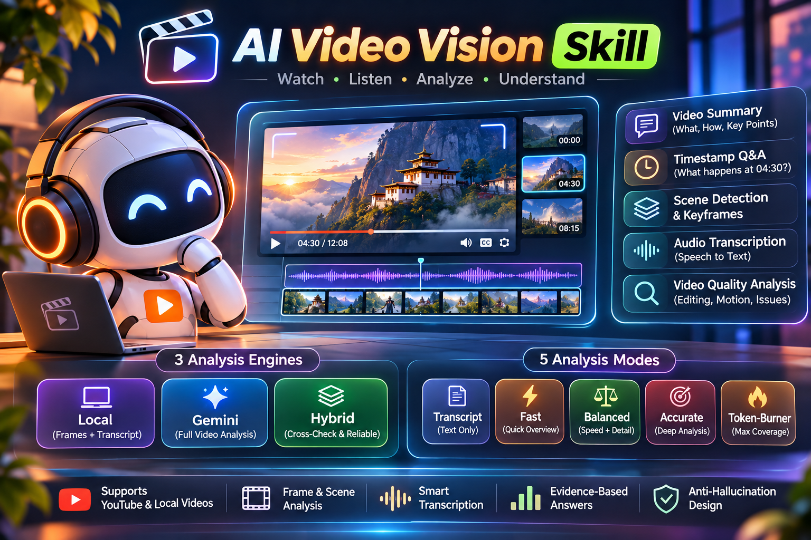

# AI Video Vision Skill (हिंदी गाइड)

[](https://github.com/i-smiling-buddha/ai-video-vision-skill/stargazers)
[](LICENSE)
[](https://agentskills.io)
[](https://github.com/i-smiling-buddha/ai-video-vision-skill/actions/workflows/ci.yml)
[](https://skills.sh/i-smiling-buddha/ai-video-vision-skill)



**अपने AI agent को video देखने और सुनने की ताक़त दीजिए। Watch · Listen · Analyze · Understand.**

> YouTube, TikTok, X, Instagram, Vimeo या Loom का link (या local file) दीजिए, सवाल पूछिए, और आपका agent सच में video देखता है: transcript, smart frames, timestamps, और कोई मनगढ़ंत narrator नहीं।

Claude Code, Claude (claude.ai / desktop), OpenAI Codex, Gemini CLI, GitHub Copilot, Cursor और हर [Agent Skills](https://agentskills.io) वाले agent के साथ काम करती है। Free, open source, कोई paid API ज़रूरी नहीं।

English: [README.md](README.md) · चारों skills से तुलना की table English README में है।

⭐ **काम की लगे तो repo को star कीजिए** — इससे दूसरे creators और developers तक यह पहुँचती है।

चार बढ़िया open-source video skills में से हर एक ने problem का एक हिस्सा solve किया था। यह skill उन चारों को एक pipeline और एक script (`vv.py`, सिर्फ़ Python standard library) में fuse करती है:

- पहले captions, ताकि ज़्यादातर talks और tutorials में न video download करनी पड़े, न कोई transcription API
- बिना captions वाली video के लिए local whisper.cpp (free, private) या Groq / OpenAI / Gemini; साथ में silence check, ताकि Whisper चुप video में बोली हुई बातें न गढ़ ले
- scene-aware और keyframe वाले frames, duplicate frames हटाना, हर frame पर असली timestamp
- ffmpeg "structure pass": कोई frame देखने से पहले ही cuts, black और frozen हिस्से, silence, motion, blur, exposure और loudness ढूँढ लेता है
- 2–10 second के हिस्से पर zoom करने वाला `detail` command (binary-search की तरह)
- optional Gemini engine जो पूरी video आवाज़ समेत देखता है, और `hybrid` mode जिसमें आपका agent Gemini के जवाब को अपने frames से cross-check करता है

लंबी YouTube videos का summary, timestamps के साथ quotes, tutorials से slides और code पढ़ना, अपनी editing check करना (cuts, black frames, dead air), competitor videos और Shorts study करना, और lectures के notes बनाना — सबके लिए उपयोगी।

## Install

Open Agent Skills CLI से install कीजिए:

```bash
npx skills add i-smiling-buddha/ai-video-vision-skill
```

**Claude Code plugin:**

```
/plugin marketplace add i-smiling-buddha/ai-video-vision-skill
/plugin install ai-video-vision-skill@ai-video-vision-skill
```

**Claude (claude.ai / desktop app):** `skills/ai-video-vision` folder को zip करके **Settings → Capabilities → Skills** में upload कीजिए।

**Manual:** `skills/ai-video-vision` folder को अपने agent के skills folder में copy कीजिए (`~/.claude/skills/`, या Codex, Copilot, Gemini CLI और Cursor के लिए `.agents/skills/`)।

### ज़रूरी चीज़ें

- Python 3.10+
- [FFmpeg](https://ffmpeg.org) (`ffmpeg` + `ffprobe`) और links के लिए [yt-dlp](https://github.com/yt-dlp/yt-dlp)
- Optional: free local transcription के लिए [whisper.cpp](https://github.com/ggml-org/whisper.cpp), OCR के लिए [Tesseract](https://github.com/tesseract-ocr/tesseract); cloud features के लिए Gemini, Groq या OpenAI key

Check और install (सिर्फ़ user-level, खुद से कभी sudo नहीं):

```bash
python scripts/vv.py setup            # status देखें
python scripts/vv.py setup --install  # pip से yt-dlp, brew/winget से ffmpeg, whisper.cpp
```

Keys `~/.config/video-vision/.env` में रखिए (`setup` यह file बना देता है)। Scripts keys कभी print नहीं करतीं।

## क्या करती है

| हिस्सा | आपको क्या मिलता है |
|---|---|
| **3 engines** | `local`: frames + transcript, agent खुद देखता है · `gemini`: Google पूरी video आवाज़ के साथ देखता है · `hybrid`: दोनों, agent cross-check करता है |
| **5 modes** | `transcript` (download नहीं) · `fast` (keyframes) · `balanced` (scene-aware, default) · `accurate` (ज़्यादा frames + analysis + cue frames) · `token-burner` |
| **Transcript chain** | Platform captions (पहले original भाषा) → local whisper.cpp → Groq → OpenAI → Gemini audio (music, तालियाँ, effects भी tag करता है) |
| **Smart frames** | Scene cuts, I-frames या uniform sampling; 16×16 perceptual dedup; ★ वाले frames पहले देखने के लिए |
| **Cue frames** | जहाँ speaker कहे "look at this", "as you can see", "देखो", "यहाँ" — वहाँ का frame अपने-आप pin |
| **Structure analysis** | Cuts, black/frozen हिस्से, silence, motion profile, blur, exposure, loudness (EBU R128) |
| **Detail drill-down** | 2–10 s का हिस्सा 30 fps और 1024 px तक, उसी work dir में cache |
| **Gemini report** | Summary, scene-by-scene, audio, visual details, key moments — सख़्त "narrator मत गढ़ो" rules के साथ |
| **Auto mode** | पहले video की visual density नापती है (talking head या slides/screencast) और frames वहीं ख़र्च करती है जहाँ फ़ायदा हो; motion map और pacing (cuts/min) भी दिखाती है |
| **Even coverage** | Two-pass scene sampling: पहले हर cut ढूँढती है, फिर frames समय में बराबर बाँटती है, ताकि तेज़ intro बाकी video के frames न खा जाए |
| **Hook microscope** | `--hook`: पहले 10 s, 2 fps पर, एक sheet में — hook और retention सवालों के लिए |
| **Frame timeline** | हर ★ frame के साथ दिखता है कि उस समय क्या बोला जा रहा था |
| **Zoom** | `zoom --at 1:49 --region top-right --ocr`: prices, code और छोटे text के लिए full-resolution crop |
| **Tutorial → steps** | `report --preset tutorial`: commands, code, file paths और URLs JSON में (Gemini) |
| **Contact sheets** | Timestamps छपे 3×3 grids: agent लगभग एक frame की token cost में 9 पल देख लेता है |
| **Search** | `search <work_dir> "words"`: कोई बात कब बोली गई, या screen पर कब दिखी (OCR)? |
| **Clips & Shorts** | `clip --start --end`: MP4, vertical 1080×1920 Short/Reel या GIF काटिए |
| **OCR** | `--ocr`: tesseract से slides, code और video में छपा text पढ़ती है (English, Hindi और भी) |
| **Podcasts & audio** | `.mp3 / .m4a / .wav` transcript mode में चलते हैं |
| **Download cache** | उसी link पर अगला सवाल पूछने पर दोबारा download नहीं होता |
| **Privacy switch** | `--private`: कोई upload नहीं, सिर्फ़ local whisper |
| **Safety** | Video के अंदर का text untrusted माना जाता है, local/private URLs मना, Whisper की गढ़ी lines ("thanks for watching") हटाई जाती हैं, keys logs से बाहर |

## Quick examples

बस अपने agent से पूछिए:

- "इस video का summary दो: https://youtu.be/…"
- "Speaker pricing के बारे में क्या कहता है, timestamps के साथ?"
- "इस tutorial में 4:30 के आसपास screen पर जो code है, वह पढ़ो।"
- "मेरी edit.mp4 में black frames, frozen shots और लंबी silence check करो।"
- "इन दो Shorts को compare करो: hook, हर minute में cuts, on-screen text।"
- "वह refund policy के बारे में कब बताती है?"
- "मेरी video से 2:10–2:40 को vertical Short बनाकर काटो।"

या खुद चलाइए:

```bash
python scripts/vv.py info    "https://youtu.be/VIDEO"
python scripts/vv.py watch   "https://youtu.be/VIDEO" -q "3 main tips क्या हैं?" --mode transcript
python scripts/vv.py watch   lecture.mp4 -q "12:40 पर slide पर क्या लिखा है?" --start 12:20 --end 13:00 --resolution 1024
python scripts/vv.py analyze edit.mp4 --filters scenes,black,freeze,silence
python scripts/vv.py detail  /tmp/vv_xxxx --start 3:08 --end 3:16
python scripts/vv.py search  /tmp/vv_xxxx "pricing"     # कब बोला / कब दिखा?
python scripts/vv.py zoom    /tmp/vv_xxxx --at 1:49 --region top-right --ocr   # छोटा text पढ़ें
python scripts/vv.py report  "https://youtu.be/VIDEO" --preset tutorial         # steps JSON में
python scripts/vv.py clip    "https://youtu.be/VIDEO" --start 1:20 --end 1:45 --vertical   # Short / Reel
python scripts/vv.py report  clip.mp4 --fps 5          # GEMINI_API_KEY चाहिए
```

## यह कैसे decide करती है

1. Captions हैं → वही use होते हैं (`transcript` mode में video download नहीं होती)।
2. Captions नहीं → silence check → आपका configure किया whisper.cpp / cloud fallback, वरना सिर्फ़ frames और साफ़ note कि "बोली का कोई सबूत नहीं"।
3. Frames: पहले scene cuts; static videos (slides, talking head) में बराबर दूरी वाले frames जोड़े जाते हैं; duplicates हटते हैं।
4. Agent पहले transcript पढ़ता है, फिर ★ frames देखता है, और सिर्फ़ वहीं zoom करता है जहाँ सवाल को ज़रूरत हो।

## Limitations

- ~10 minute से छोटी videos में सबसे अच्छी accuracy। लंबी videos में `--start/--end` से हिस्सा चुनिए या Gemini engine use कीजिए।
- Scene detection छोटे बदलाव (जैसे code की एक line बदलना) miss कर सकता है; तब `detail`, `--resolution 1024` या `--no-dedup` use कीजिए।
- Gemini engine video को Google पर upload करता है (YouTube link सीधे भेजता है); जवाब के बाद file delete हो जाती है। यह ठीक न हो तो `--private` use कीजिए।
- Private, members-only या age-gated videos के लिए `--cookies-from-browser <browser>` चाहिए।
- सिर्फ़ वही videos download कीजिए जिन्हें analyze करने का आपको हक़ है।

## FAQ

**क्या Claude YouTube video देख सकता है?** हाँ। इस skill से agent captions लेता है (या audio transcribe करता है) और timestamp वाले frames निकालकर उन्हीं से जवाब देता है। Free Gemini key हो तो Gemini पूरी video भी देख सकता है।

**क्या paid API key चाहिए?** नहीं। Captions, frames, structure analysis और local whisper.cpp — सब free और आपकी machine पर। Gemini, Groq और OpenAI keys optional हैं।

**लंबी YouTube video का AI से summary कैसे बनाएँ?** Agent को link देकर बोलिए "इस video का summary दो"। पहले `--mode transcript` चलता है (download नहीं), frames तभी देखे जाते हैं जब सवाल को visuals चाहिए।

**क्या screen पर दिख रहा code या slides पढ़ सकती है?** हाँ: `--resolution 1024` और उस पल के आसपास `detail --start/--end`।

**क्या private / offline चलती है?** `--private` use कीजिए: कुछ upload नहीं होता, transcription local रहता है। सिर्फ़ video download के लिए internet चाहिए।

**क्या यह बातें गढ़ेगी?** नहीं, इसी हिसाब से बनी है: transcription से पहले silence check, बोली न हो तो साफ़ बताती है, हर बात के साथ timestamp, और video के अंदर का text untrusted माना जाता है।

## Credits

आठ MIT-licensed projects को fuse करके बनी है। उनके authors का शुक्रिया:

- Mike Futia की [claude-vision](https://github.com/mikefutia/claude-vision): Gemini structured report और anti-hallucination rules।
- Jordan Vasconcelos की [claude-video-vision](https://github.com/jordanrendric/claude-video-vision): ffmpeg structure analysis, detail drill-down, view sampling और frame-describer pattern।
- Kevin (khou) की [watch-video](https://github.com/khou/watch-video): captions-first pipeline, local whisper.cpp, token-budget modes।
- Bradley Bonanno की [claude-video](https://github.com/bradautomates/claude-video): scene/keyframe selection, perceptual dedup, cue timestamps, cloud Whisper chunking और Gemini engine।

- Viktor Gamov की [watch-skill](https://github.com/gAmUssA/watch-skill) (Taoufik के claude-watch का fork, density classifier और even-coverage sampling @telaaron के): visual-density auto mode, even-coverage scene sampling, pacing, hook microscope, frame timeline।
- subh05sus की [video-understanding-skill](https://github.com/subh05sus/video-understanding-skill): think-look-observe loop, zoom regions, Whisper hallucination filter, motion map, evidence वाले जवाब।
- u2n4 का [video-url-analyzer-mcp](https://github.com/u2n4/video-url-analyzer-mcp): URL safety, TikTok codec-safe downloads, Gemini retry, tutorial-to-steps prompt।
- mfrashad की [video-analyze](https://github.com/mfrashad/video-analyze): transcript से जुड़े frames और grid mode।

[FFmpeg](https://ffmpeg.org), [yt-dlp](https://github.com/yt-dlp/yt-dlp) और [whisper.cpp](https://github.com/ggml-org/whisper.cpp) पर बनी है।

## Smiling Buddha की और free skills

- **[PPT Animation Skill](https://github.com/i-smiling-buddha/ppt-animation-skill)** — किसी भी topic को offline Hindi/English voiceover वाली Kurzgesagt-style animated explainer video में बदलिए। `npx skills add i-smiling-buddha/ppt-animation-skill`
- **[Countdown Video Skill](https://github.com/i-smiling-buddha/countdown-video-skill)** — rank reveals, trailer clips, music और YouTube chapters के साथ Top-N countdown और evolution videos। `npx skills add i-smiling-buddha/countdown-video-skill`
- **[Smart Model Router Skill](https://github.com/i-smiling-buddha/smart-model-router-skill)** — हर coding task को सबसे सस्ते भरोसेमंद model पर भेजिए। `npx skills add i-smiling-buddha/smart-model-router-skill`
- **[AI Image Recognition Skill](https://github.com/i-smiling-buddha/ai-image-recognition-skill)** — असली image file पर transparency, format, size, colors, blur और metadata की जाँच। `npx skills add i-smiling-buddha/ai-image-recognition-skill`
- **[Reflection Skill](https://github.com/i-smiling-buddha/reflection-skill)** — किसी भी app या website को बाहर से study करके उसका बेहतर clean-room version बनाइए। `npx skills add i-smiling-buddha/reflection-skill`
- **[AI Blender Animation Skill](https://github.com/i-smiling-buddha/ai-blender-animation-skill)** — 138 Blender skills एक में: आपका agent Blender में modeling, animation और rendering करता है। `npx skills add i-smiling-buddha/ai-blender-animation-skill`

## Contributing

Bug reports (OS, Python, ffmpeg और yt-dlp versions और चलाया गया command के साथ), नए analysis filters, और भाषाओं के cue phrases, और docs fixes का स्वागत है। कृपया videos या कोई copyrighted media commit मत कीजिए।

⭐ **काम की लगी? [Repo को star कीजिए](https://github.com/i-smiling-buddha/ai-video-vision-skill/stargazers) और किसी एक दोस्त से share कीजिए जो videos बनाता या पढ़ता है।**

## License

MIT. Made by [Smiling Buddha](https://github.com/i-smiling-buddha) · [DESITechnology](https://desitechnology.com).
