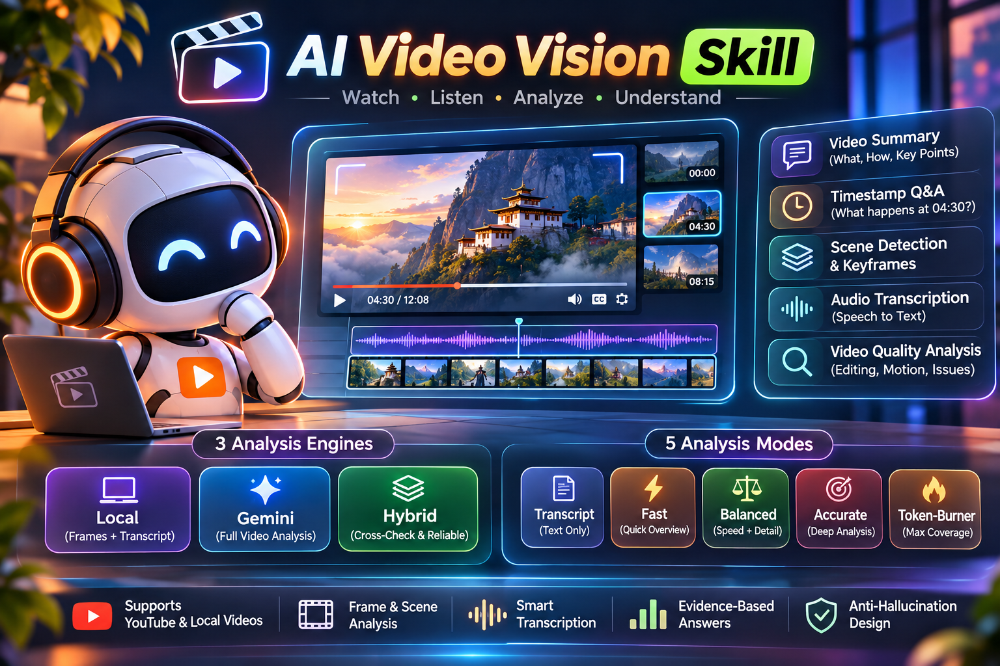

# AI Video Vision Skill

[](https://github.com/i-smiling-buddha/ai-video-vision-skill/stargazers)
[](LICENSE)
[](https://agentskills.io)
[](https://github.com/i-smiling-buddha/ai-video-vision-skill/actions/workflows/ci.yml)
[](https://skills.sh/i-smiling-buddha/ai-video-vision-skill)



**Give your AI agent eyes and ears for video. Watch · Listen · Analyze · Understand.**

> Paste a YouTube, TikTok, X, Instagram, Vimeo or Loom link (or a local file), ask a question, and your agent actually watches it: transcript, smart frames, timestamps, no made-up narrators.

Works with **Claude Code, Claude (claude.ai / desktop), OpenAI Codex, Gemini CLI, GitHub Copilot, Cursor** and any agent that supports [Agent Skills](https://agentskills.io). Free, open source, no paid API required.

[Install](#install) · [What it does](#what-it-does) · [Why one skill instead of four](#why-one-skill-instead-of-four) · [Examples](#quick-examples) · [FAQ](#faq) · हिंदी गाइड: [README.hi.md](README.hi.md)

⭐ **If it saves you time, star the repo** — it helps other creators and developers find it.

Four great open-source video skills each solved one part of the problem. This skill fuses all of them into one pipeline with one script (`vv.py`, Python standard library only):

- captions first, so most talks and tutorials never need a download or a transcription API
- local whisper.cpp (free, private) or Groq / OpenAI / Gemini as speech fallback, with a silence check so Whisper can't invent speech on silent clips
- scene-aware and keyframe frame picking, near-duplicate removal, real source timestamps on every frame
- an ffmpeg "structure pass" that finds cuts, black and frozen stretches, silences, motion, blur, exposure and loudness before any frame is viewed
- a drill-down command for 2–10 second windows, binary-search style
- an optional Gemini engine that watches the whole video with sound, plus a `hybrid` mode where your agent cross-checks Gemini against its own frames

Useful for summarizing long YouTube videos, pulling quotes with timestamps, reading slides and code from tutorials, reviewing your own edits (cuts, black frames, dead air), studying competitor videos and Shorts, and making notes from lectures.

## Why one skill instead of four

| Capability | claude-vision | claude-video-vision | watch-video | claude-video | **AI Video Vision** |
|---|:-:|:-:|:-:|:-:|:-:|
| YouTube / TikTok / X / Instagram links | – | YouTube | ✓ | ✓ | **✓** |
| Captions first (no transcription cost) | – | ✓ | ✓ | ✓ | **✓** |
| Free local transcription (whisper.cpp) | – | ✓ | ✓ | WhisperX | **✓** |
| Groq / OpenAI / Gemini speech fallback | – | partly | – | ✓ | **✓** |
| Scene / keyframe frames + dedup | – | – | – | ✓ | **✓** |
| "Look at this" cue frames | – | – | – | manual | **auto + manual** |
| ffmpeg structure analysis | – | ✓ | – | – | **✓** |
| Detail drill-down windows | – | ✓ | – | – | **✓** |
| Gemini watches the full video | ✓ | audio | – | ✓ | **✓** |
| Hybrid cross-check (Gemini vs own frames) | – | – | – | – | **✓** |
| Anti-hallucination report | ✓ | – | – | – | **✓** |
| No Node / MCP server needed | ✓ | – | ✓ | ✓ | **✓** |

## Install

Install with the open Agent Skills CLI:

```bash
npx skills add i-smiling-buddha/ai-video-vision-skill
```

**Claude Code plugin:**

```
/plugin marketplace add i-smiling-buddha/ai-video-vision-skill
/plugin install ai-video-vision-skill@ai-video-vision-skill
```

**Claude (claude.ai / desktop app):** zip the `skills/ai-video-vision` folder and upload it under **Settings → Capabilities → Skills**.

**Manual:** copy `skills/ai-video-vision` into your agent's skills folder (`~/.claude/skills/`, or `.agents/skills/` for Codex, Copilot, Gemini CLI and Cursor).

### Requirements

- Python 3.10+
- [FFmpeg](https://ffmpeg.org) (`ffmpeg` + `ffprobe`) and [yt-dlp](https://github.com/yt-dlp/yt-dlp) for links
- Optional: [whisper.cpp](https://github.com/ggml-org/whisper.cpp) for free local transcription, [Tesseract](https://github.com/tesseract-ocr/tesseract) for OCR; a Gemini, Groq or OpenAI key for cloud features

Check and install (user-level only, never sudo by itself):

```bash
python scripts/vv.py setup            # status
python scripts/vv.py setup --install  # yt-dlp via pip, ffmpeg via brew/winget, whisper.cpp
```

Keys go in `~/.config/video-vision/.env` (created by `setup`). The scripts never print them.

## What it does

| Part | What you get |
|---|---|
| **3 engines** | `local`: frames + transcript, your agent looks · `gemini`: Google watches the full video with sound · `hybrid`: both, agent cross-checks |
| **5 modes** | `transcript` (no download) · `fast` (keyframes) · `balanced` (scene-aware, default) · `accurate` (dense + analysis + cue frames) · `token-burner` |
| **Transcript chain** | Platform captions (original language first) → local whisper.cpp → Groq → OpenAI → Gemini audio (also tags music, applause, effects) |
| **Smart frames** | Scene cuts, I-frames or uniform sampling; 16×16 perceptual dedup; ★ marks the frames to view first |
| **Cue frames** | Auto-pins frames where the speaker says "look at this", "as you can see", "देखो", "यहाँ" |
| **Structure analysis** | Cuts, black/frozen stretches, silences, motion profile, blur, exposure, loudness (EBU R128) |
| **Detail drill-down** | 2–10 s windows at up to 30 fps and 1024 px, cached in the same work dir |
| **Gemini report** | Summary, scene-by-scene, audio, visual details, key moments, with strict "don't invent narrators" rules |
| **Auto mode** | measures visual density first (talking head vs slides/screencast) and spends frames only where they pay off; prints a motion map and pacing (cuts/min) |
| **Even coverage** | two-pass scene sampling: every cut is found, then frames are spread evenly in time, so a fast intro can't starve the rest |
| **Hook microscope** | `--hook`: the first 10 s at 2 fps in one sheet, for hook and retention questions |
| **Frame timeline** | every ★ frame shows what is said while it is on screen |
| **Zoom** | `zoom --at 1:49 --region top-right --ocr`: full-resolution crop for prices, code and small text |
| **Tutorial → steps** | `report --preset tutorial`: commands, code, file paths and URLs as JSON (Gemini) |
| **Contact sheets** | 3×3 grids with burned-in timestamps: your agent sees 9 moments for about the token cost of one frame |
| **Search** | `search <work_dir> "words"`: when was it said, or shown on screen (OCR)? |
| **Clips & Shorts** | `clip --start --end`: cut an MP4, a vertical 1080×1920 Short/Reel or a GIF |
| **OCR** | `--ocr`: reads slides, code and burned-in text with tesseract (English, Hindi and more) |
| **Podcasts & audio** | `.mp3 / .m4a / .wav` work in transcript mode |
| **Download cache** | follow-up questions on the same link don't download again |
| **Privacy switch** | `--private`: no uploads, local whisper only |
| **Safety** | Video text is treated as untrusted content, local/private URLs are refused, Whisper hallucinations ("thanks for watching") are filtered, keys stay out of logs |

## Quick examples

Just ask your agent:

- "Summarize this video: https://youtu.be/…"
- "What does the speaker say about pricing, with timestamps?"
- "Read the code on screen around 4:30 in this tutorial."
- "Check my edit.mp4 for black frames, frozen shots and long silences."
- "Compare these two Shorts: hook, cuts per minute, on-screen text."
- "When does she mention the refund policy?"
- "Cut 2:10–2:40 from my video as a vertical Short."

Or run it yourself:

```bash
python scripts/vv.py info    "https://youtu.be/VIDEO"
python scripts/vv.py watch   "https://youtu.be/VIDEO" -q "What are the 3 main tips?" --mode transcript
python scripts/vv.py watch   lecture.mp4 -q "What is on the slide at 12:40?" --start 12:20 --end 13:00 --resolution 1024
python scripts/vv.py analyze edit.mp4 --filters scenes,black,freeze,silence
python scripts/vv.py detail  /tmp/vv_xxxx --start 3:08 --end 3:16
python scripts/vv.py search  /tmp/vv_xxxx "pricing"     # when was it said / shown?
python scripts/vv.py zoom    /tmp/vv_xxxx --at 1:49 --region top-right --ocr   # read small text
python scripts/vv.py report  "https://youtu.be/VIDEO" --preset tutorial         # steps as JSON
python scripts/vv.py clip    "https://youtu.be/VIDEO" --start 1:20 --end 1:45 --vertical   # Short / Reel
python scripts/vv.py report  clip.mp4 --fps 5          # needs GEMINI_API_KEY
```

## How it decides

1. Captions exist → use them (no video download in `transcript` mode).
2. No captions → silence check → whisper.cpp / cloud fallback you configured, or frames only with an honest "no speech evidence" note.
3. Frames: scene cuts first; static videos (slides, talking head) are topped up with evenly spread frames; duplicates removed.
4. The agent reads the transcript, views the ★ frames, then drills only where the question needs it.

## Limitations

- Best accuracy under ~10 minutes. For long videos, narrow with `--start/--end` or use the Gemini engine.
- Scene detection can miss subtle changes such as one line of code changing; use `detail`, `--resolution 1024` or `--no-dedup`.
- The Gemini engine uploads the video (or sends the YouTube link) to Google; the file is deleted after the answer. Use `--private` when that's not OK.
- Private, members-only or age-gated videos need `--cookies-from-browser <browser>`.
- Only download videos you have the right to analyze.

## FAQ

**Can Claude watch YouTube videos?** Yes. With this skill your agent pulls the captions (or transcribes the audio) and extracts timestamped frames, then answers from that evidence. With a free Gemini key it can also have Gemini watch the whole video.

**Does it need a paid API key?** No. Captions, frames, structure analysis and local whisper.cpp transcription are free and run on your machine. Gemini, Groq and OpenAI keys are optional.

**How do I summarize a long YouTube video with AI?** Ask your agent "summarize this video" with the link. It uses `--mode transcript` first (no download), then looks at frames only if the question needs visuals.

**Can it read code or slides shown on screen?** Yes: `--resolution 1024` plus `detail --start/--end` around the moment.

**Does it work offline / privately?** Use `--private`: nothing is uploaded and transcription stays local. Only the video download itself needs the internet.

**Will it make things up?** It is built not to: silent audio is detected before transcription, missing speech is reported as missing, every claim needs a timestamp, and video text is treated as untrusted content.

**Which agents does it support?** Any Agent Skills-compatible agent: Claude Code, Claude apps, Codex, Gemini CLI, Copilot, Cursor and more.

## Credits

Fused from eight MIT-licensed projects. Thank you to their authors:

- [claude-vision](https://github.com/mikefutia/claude-vision) by Mike Futia: the Gemini structured report and anti-hallucination rules.
- [claude-video-vision](https://github.com/jordanrendric/claude-video-vision) by Jordan Vasconcelos: ffmpeg structure analysis, detail drill-down, view sampling and the frame-describer pattern.
- [watch-video](https://github.com/khou/watch-video) by Kevin (khou): captions-first pipeline, local whisper.cpp, token-budget modes.
- [claude-video](https://github.com/bradautomates/claude-video) by Bradley Bonanno: scene/keyframe selection, perceptual dedup, cue timestamps, cloud Whisper chunking and the Gemini engine.

- [watch-skill](https://github.com/gAmUssA/watch-skill) maintained by Viktor Gamov (fork of Taoufik’s claude-watch, with the density classifier and even-coverage sampling by @telaaron): visual-density auto mode, even-coverage scene sampling, pacing metrics, hook microscope, frame timeline.
- [video-understanding-skill](https://github.com/subh05sus/video-understanding-skill) by subh05sus: the think-look-observe loop, zoom regions, Whisper hallucination filter, motion map and evidence-style answers.
- [video-url-analyzer-mcp](https://github.com/u2n4/video-url-analyzer-mcp) by u2n4: URL safety checks, TikTok codec-safe downloads, Gemini retry, tutorial-to-steps prompt.
- [video-analyze](https://github.com/mfrashad/video-analyze) by mfrashad: frames aligned to the transcript and tiled grid mode.

Built on [FFmpeg](https://ffmpeg.org), [yt-dlp](https://github.com/yt-dlp/yt-dlp) and [whisper.cpp](https://github.com/ggml-org/whisper.cpp).

## More free skills by Smiling Buddha

- **[PPT Animation Skill](https://github.com/i-smiling-buddha/ppt-animation-skill)** — turn any topic into a Kurzgesagt-style animated explainer video with an offline Hindi/English voiceover. `npx skills add i-smiling-buddha/ppt-animation-skill`
- **[Countdown Video Skill](https://github.com/i-smiling-buddha/countdown-video-skill)** — Top-N countdown and year-by-year evolution videos with rank reveals, trailer clips, music and YouTube chapters. `npx skills add i-smiling-buddha/countdown-video-skill`
- **[Smart Model Router Skill](https://github.com/i-smiling-buddha/smart-model-router-skill)** — route each coding task to the cheapest model that can reliably do it. `npx skills add i-smiling-buddha/smart-model-router-skill`
- **[AI Image Recognition Skill](https://github.com/i-smiling-buddha/ai-image-recognition-skill)** — real transparency, format, size, colors, blur and metadata checks on the actual image file. `npx skills add i-smiling-buddha/ai-image-recognition-skill`
- **[Reflection Skill](https://github.com/i-smiling-buddha/reflection-skill)** — study any app or website from the outside and build a better clean-room version. `npx skills add i-smiling-buddha/reflection-skill`
- **[AI Blender Animation Skill](https://github.com/i-smiling-buddha/ai-blender-animation-skill)** — 138 Blender skills fused into one: your agent models, animates and renders in Blender. `npx skills add i-smiling-buddha/ai-blender-animation-skill`

## Contributing

Run the tests with `python -m unittest discover -s tests -v` (needs only ffmpeg). Bug reports (with OS, Python, ffmpeg and yt-dlp versions and the command you ran), new analysis filters, better cue phrases in more languages and docs fixes are welcome. Please don't commit videos or other copyrighted media.

⭐ **Found it useful? [Star the repo](https://github.com/i-smiling-buddha/ai-video-vision-skill/stargazers) and share it with one friend who makes or studies videos.**

## License

MIT. Made by [Smiling Buddha](https://github.com/i-smiling-buddha) · [DESITechnology](https://desitechnology.com).
